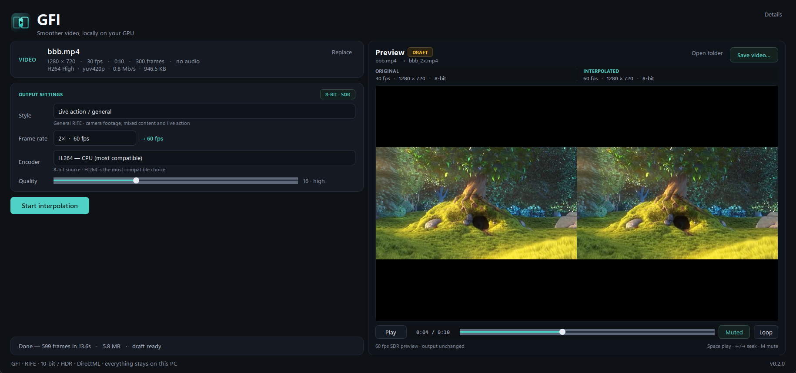

<p align="center">
  
</p>

<h1 align="center">GFI</h1>

<p align="center"><strong>Generate Frame Inbetween</strong><br>
A small, pipelined video frame interpolation app for Windows.</p>

**GFI** pairs a clean desktop window with a streaming engine built around RIFE,
ONNX Runtime and FFmpeg.

The point is the pipeline: frames are decoded, interpolated and re-encoded
concurrently over pipes. Nothing is written to a PNG sequence, so the GPU is
not waiting on the disk.

```
ffmpeg decode ──► ring buffer ──► RIFE (DirectML) ──► ordered writer ──► ffmpeg encode
       │                                                                       │
       └── scene-cut check ────────────────────────────────────────────────────┘
```

## Status

GFI v0.1.0 is the first public release: a portable Windows build with the
10-bit/HDR pipeline, Anime/Cartoon profile, permanent two-pane preview, and
temporary render drafts. Validated on an **RX 9060 XT 8 GB** with DirectML,
including 10-bit SDR and HDR10 sources.

| input | factor | output rate | wall time | output fps |
|---|---|---|---|---|
| 1280x720 30 fps, 6 s | 2x | 60 | 7.5 s | 48 |
| 1920x1080 30 fps, 5 s | 2x | 60 | 13.2 s | 22.6 |
| 3840x2160 30 fps, 2 s | 2x | 60 | 61.6 s | 1.9 |
| 1280x720 30 fps, 6 s | 4x | 120 | 20.4 s | 35.2 |

These are engine/CLI benchmarks; the desktop window caps its output-rate menu at 120 fps.

Quality check on a synthetic 60 fps source (drop every other frame, interpolate
back, compare against the original):

| method | PSNR |
|---|---|
| duplicate frames | 32.24 dB |
| **GFI / RIFE** | **36.87 dB** |

Scene cuts are detected before interpolation. On a hard cut, the engine skips
the intermediate rather than producing a morph frame:

| scene detection | output frames (4 s, 120 in) |
|---|---|
| on | 238 |
| off | 239 |

## Download and run (Windows)

Download the latest `GFI-*-win64.zip` from the repository's **Releases** page.

1. Verify the download with the `SHA256SUMS` file:
   ```powershell
   Get-FileHash .\GFI-0.1.0-win64.zip -Algorithm SHA256
   ```
2. Right-click the zip, open **Properties**, tick **Unblock**, then extract it to a
   writable folder such as Desktop, Documents, or a USB drive. Do not use Program
   Files: GFI writes its settings and drafts next to `gfi.exe`.
3. Run `gfi.exe`.

Python, FFmpeg, model downloads, installation, and administrator rights are not
needed. The portable build keeps settings, drafts, and preview cache in
`gfi-data\` next to `gfi.exe`; delete the folder to remove everything.

The build is currently unsigned, so Windows SmartScreen may show **Unknown
publisher** on first launch. Choose **More info → Run anyway**. Unblocking the zip
before extracting avoids some of these prompts. If the app grows, the release can
be signed later without changing the portable layout.

## Requirements

The portable build includes Python, FFmpeg, and both models. The list below applies
to source checkouts.


- Windows 10/11 (the pipeline is portable; DirectML is the Windows path)
- Python 3.10+
- FFmpeg with `ffmpeg`/`ffprobe` on `PATH`, or `FFMPEG_BIN` / `FFPROBE_BIN`
  pointing at the executables. A full build with `zscale`, `tonemap`,
  `libx264`, `libx265`, and optionally `hevc_amf` / `av1_amf`. The preview
  proxy uses the `sidedata` filter, so a recent build (FFmpeg 7.1+ recommended)
  is needed for its HDR metadata cleanup.
- A DirectML-capable GPU (NVIDIA, AMD, or Intel). CPU works but is considerably
  slower.
- HDR output needs HEVC or AV1. `libx265` is the portable choice; `hevc_amf`
  and `av1_amf` are the AMD hardware paths.

## Setup

```powershell
python -m venv .venv
# CLI only:
.\.venv\Scripts\pip install -e .
# CLI + desktop window:
.\.venv\Scripts\pip install -e ".[gui]"
python scripts\fetch_model.py
```

`fetch_model.py` downloads both models by default. To fetch just one:

```powershell
python scripts\fetch_model.py --profile anime
python scripts\fetch_model.py --profile live
```

If FFmpeg is missing:

```powershell
winget install Gyan.FFmpeg
```

| profile | model | size | scene threshold |
|---|---|---|---|
| Live action / general | `RIFE_fp32_timestep.onnx` | 21.6 MB | 0.25 |
| Anime / cartoon | `RIFE_4.9.onnx` | 21.5 MB | 0.15 |

Both model downloads are pinned to a SHA-256 in `scripts/fetch_model.py`. They
are MIT-licensed RIFE exports. The Anime/Cartoon profile uses RIFE 4.9, which
keeps animation lines sharper, and a lower scene-cut threshold so hard
animation cuts do not produce a morph frame.

### Build the portable zip

After installing the GUI dependencies and fetching the models:

```powershell
pip install -r requirements-build.txt
python scripts\build_release.py
```

The build downloads the pinned Gyan FFmpeg 9.0.2 full build, verifies its SHA-256,
bundles the models and assets, and writes `dist\GFI-<version>-win64.zip` plus
`dist\SHA256SUMS`. To reuse an installed Gyan 9.0.2 full build instead of
downloading it, pass `--ffmpeg-bin-dir "C:\path\to\ffmpeg\bin"`.

The desktop entry point is `gfi.exe`; the CLI is `gfi-cli` (or `python -m gfi`).
The previous `inbetween.exe` / `inbetween-cli` names remain available as
compatibility aliases.

## Desktop window

```powershell
.\.venv\Scripts\gfi.exe
```



Drop a video anywhere on the window (or click the drop zone), choose a frame
rate and press **Start interpolation**. After loading, the source card gets a
**Replace** button and the drop zone collapses; dropping another file on the
window works too. Native dialogs and Explorer drops can leave focus with the
previous window, so GFI re-activates itself after loading. Its `ffprobe`
check runs without a console window, so it cannot flash over the app either.

The window is a permanent two-pane workspace: settings on the left and a live
preview on the right. The splitter can be dragged and the layout is remembered.
There is no output-path field before rendering. GFI writes each render to a
temporary draft, then loads the comparison preview automatically (paused, with
a **Play** button). The preview header shows the source and suggested output
name plus a **DRAFT** or **SAVED** badge.

Use **Save video…** in the preview header or **Ctrl+S** to copy the draft to a
permanent location. The copy happens in the background and the draft stays
available for further previews; **Open folder** becomes available as soon as a
saved copy exists. Closing or loading another video with an unsaved draft asks
whether to save it, discard it, or cancel. A successful render plays a Windows
notification sound without opening a completion popup or stealing focus. A
failed render keeps the previous draft and still shows the usual error dialog.

Portable builds keep drafts under `gfi-data\drafts` next to `gfi.exe`; source
runs use `%LOCALAPPDATA%\GFI\drafts`. Only one draft is active at a time: a new
render replaces it only after succeeding, so a failure or cancel never removes
the last good result. Saved copies are independent files and are not touched by
later renders or draft cleanup.

The window remembers your style, encoder, HDR mode, quality, frame rate, size
and workspace split; preferences from the previous Inbetween name are migrated
automatically. Old compact-window geometry is intentionally ignored so the
first launch opens the full two-pane layout. **Cancel** stops the job and
removes the partial draft. **Details** shows engine messages and warnings; a
failure opens it automatically.

### Style

- **Live action / general** — the default RIFE model for camera footage and
  mixed content.
- **Anime / cartoon** — RIFE 4.9 plus a lower scene-cut threshold.

### 10-bit and HDR

The output depth is automatic:

| source | output |
|---|---|
| 8-bit SDR | 8-bit `yuv420p` (H.264 by default) |
| 10-bit SDR | 10-bit `yuv420p10le` (HEVC automatically) |
| HDR10 / HLG | 10-bit HDR `yuv420p10le`, color tags preserved |

For HDR sources, **HDR output** offers:

- **Preserve HDR10 / HLG (10-bit)** — keeps the source transfer function
  (PQ or HLG), primaries and matrix, and writes a 10-bit HEVC/AV1 file. This is
  the default. RIFE interpolates in the source transfer-encoded RGB space; the
  result is not converted to linear light or tone-mapped.
- **Tone-map to SDR (10-bit)** — converts HDR to SDR BT.709 while retaining
  10-bit precision.

HDR10/HLG color tags are copied. HDR10 mastering-display metadata and Dolby
Vision dynamic metadata are not copied. For SDR sources with incomplete color
tags, GFI uses a complete BT.709 fallback rather than letting a hardware
encoder guess (which could incorrectly label SDR as HDR).

HDR output requires HEVC or AV1. The window automatically switches to a
compatible encoder when a 10-bit or HDR source loads.

### Frame rate

The frame-rate menu offers the multipliers that stay within the 120 fps cap and
a **Desired FPS…** mode for an exact rate up to 120 fps. A 24 fps 1080p clip can
become 48 fps at 2×, 96 fps at 4×, or exactly 120 fps with Desired FPS → 120.
Desired-FPS output is generated directly on the target timeline, so every output
timestamp is uniform; it is not oversampled and resampled. Multiplier choices
that would exceed 120 fps are hidden; the CLI still accepts higher rates when
you need them.

### Quality

Quality defaults to CRF 16 (lower is better/larger). Dragging the quality slider
to 14 or below also switches the CPU encoder to the slower `medium` preset.

### Preview and drafts

The preview pane is always present, with the original on the left and the
interpolated result on the right. After a render it loads automatically but
stays paused so the first frame is visible instead of the video starting on its
own. GFI builds one composite 60 fps, 8-bit SDR preview file and plays it with
a single media player, so the two sides cannot drift out of sync. The pane has
play/pause, scrubbing, loop and mute controls. Keyboard shortcuts are Space
(play/pause), Left/Right (seek 5 seconds) and M (mute); they apply while focus
is inside the pane, while **Ctrl+S** saves the draft from anywhere in the
window. The splitter stays draggable and there is no close/expand toggle.

The preview is only a proxy: your draft is untouched. HDR10/HLG is tone-mapped
to SDR for reliable playback, while the draft keeps its 10-bit/HDR color tags
and full-quality encode. Portable builds cache previews under `gfi-data\compare`;
source runs use `%LOCALAPPDATA%\GFI\compare`. The cache is keyed by the
source/output paths, sizes, modification times and preview version, and is bounded
to 8 files / 3 GB. Drafts use the same data folder and are removed when GFI
closes after the save/discard decision.

You can also open a file directly:

```powershell
.\.venv\Scripts\gfi.exe "D:\videos\clip.mp4"
```

To inspect a source and output before/after a render:

```powershell
.\.venv\Scripts\python.exe scripts\inspect_video.py "D:\videos\clip.mp4" "D:\videos\clip_60fps.mp4"
```

It prints codec, bit depth, HDR tags, frame rate, bitrate and file size. A
smaller output is not automatically a bug: size is bitrate times duration, and
the encoder settings matter more than the frame count.

## Usage

The CLI keeps its explicit output-path behavior (`-o`); the draft workflow is
specific to the desktop window.

```powershell
# 2x. 8-bit sources use H.264; 10-bit/HDR sources use HEVC automatically.
python -m gfi input.mp4

# Anime / cartoon profile (RIFE 4.9)
python -m gfi episode.mp4 --profile anime -m 2

# HDR10/HLG in, 10-bit HDR out (the default for HDR)
python -m gfi hdr_clip.mp4

# HDR in, SDR BT.709 out, still 10-bit
python -m gfi hdr_clip.mp4 --hdr tonemap

# Force 8-bit SDR and H.264
python -m gfi hdr_clip.mp4 --bit-depth 8 --encoder libx264

# 10-bit SDR with the AMD hardware encoder
python -m gfi tenbit_clip.mp4 --encoder hevc_amf

# 24 fps -> exactly 120 fps on a uniform target timeline
python -m gfi input.mp4 -t 120

# Inspect the ffmpeg commands without running
python -m gfi input.mp4 --dry-run
```

| flag | meaning |
|---|---|
| `-o, --output` | output path (default `<name>_<factor>x.mp4` or `<name>_<fps>fps.mp4`) |
| `-m, --multiplier N` | integer interpolation factor (default 2) |
| `-t, --target-fps F` | exact output rate; frames are generated on the target timeline |
| `--profile` | `live` (default) or `anime` |
| `--bit-depth` | `auto` (default), `8`, or `10` |
| `--hdr` | `preserve` (default) or `tonemap` |
| `--encoder` | `libx264`, `libx265`, `h264_amf`, `hevc_amf`, `av1_amf`; auto by default |
| `--crf` | x264/x265 CRF or AMF QP (default 16) |
| `--preset` | x264/x265 preset (default `veryfast`) |
| `--scene-threshold` | mean-difference threshold, `0` disables (default 0.25 live, 0.15 anime) |
| `--model` | override the selected profile's ONNX model |
| `--provider` | `DmlExecutionProvider` (default) or `CPUExecutionProvider` |
| `--no-audio` | skip the audio track |
| `--overwrite` | replace an existing output without asking |
| `--quiet` | hide progress |
| `--dry-run` | print the FFmpeg commands and exit |

## How it works

1. `ffprobe` reads dimensions, frame rate, duration, color tags, bit depth and
   rotation. HDR10/HLG is detected from the transfer function.
2. The decoder normalizes to CFR. 8-bit SDR is emitted as `rgb24`; 10-bit
   sources use `rgb48le`, so the encoder receives real 10-bit data instead of a
   quantized 8-bit round trip. For HDR preservation, PQ/HLG RGB stays in its
   original transfer space. For tone-mapping, the HDR path converts to linear
   light, tone-maps, and returns SDR BT.709.
3. A reader thread fills a bounded queue; the main thread converts each frame
   to planar float `[1, 3, H, W]`. RIFE runs in float32 and writes back to
   `uint8` or `uint16` depending on the output depth.
4. In multiplier mode, each consecutive pair produces `N-1` intermediates at
   `t = i/N`. In target mode, the engine walks the exact target timestamps and
   interpolates only the frames that fall between source samples; it never
   generates a larger intermediate rate and resamples afterward.
5. A cheap sampled mean-difference check skips pairs at scene cuts. The Anime
   profile uses a lower threshold. Target mode holds the outgoing frame across
   the cut instead of morphing.
6. A writer thread pipes frames to a second ffmpeg, which converts RGB to YUV
   with the correct output matrix and encodes `yuv420p` or `yuv420p10le`. It
   copies the original audio and writes the color tags in the same pass. Target
   mode holds the final frame to the source duration so the output does not end
   early.

The live-action ONNX graph takes `[1, 6, H, W]` (two frames stacked) plus a
scalar `timestep`; RIFE 4.9 uses split `img0` / `img1` inputs plus `timestep`.
Both wrappers handle arbitrary resolutions without re-exporting the model.

## Known limitations

- HDR10/HLG color tags are preserved, but HDR10 mastering-display metadata and
  Dolby Vision dynamic metadata are not copied. HDR output also depends on a
  player that understands HEVC/AV1 HDR in MP4.
- RIFE interpolates PQ/HLG-encoded values directly when preserving HDR. This
  keeps the pipeline simple and avoids a costly linear-light round trip, but
  it is not a colorimetric HDR-trained interpolation model.
- 10-bit output can technically use H.264 High 10, but HEVC is the recommended
  and automatic choice. The GUI switches to HEVC when a 10-bit or HDR source
  loads.
- 4K on 8 GB VRAM fits but is slow (memory pressure). Tiling or RIFE's
  half-resolution flow mode is the next optimization.
- No frame de-duplication, loop interpolation, alpha/transparency, subtitle
  copy, or resume/batch queue yet.
- VFR sources are normalized to CFR using the average frame rate. The window
  warns when the container looks variable-rate, but timestamp-aware retiming is
  not implemented.
- The preview pane uses a generated 60 fps SDR proxy. It is intended for
  synchronized playback and does not provide frame-accurate stepping, zooming, a
  wipe view or a color-managed HDR preview.
- Scene detection is a simple sampled mean difference, not a trained detector.
- Audio is copied as-is. Multiplier mode still ends half a frame early at 2x;
  target mode holds the last frame to preserve the full duration.

## Roadmap

1. Half-resolution flow export for 4K (the biggest speed win).
2. Tiled inference for very high resolutions and low-VRAM cards.
3. Animation-aware scene detection and frame de-duplication.
4. Batch queue, resume, watch folders.
5. Color-managed linear-light interpolation for HDR.
6. Optional code signing for the Windows portable download.

## Credits

- [RIFE](https://github.com/hzwer/Practical-RIFE) — MIT, the interpolation model.
- [walterlow/RIFE_fp32_timestep](https://huggingface.co/walterlow/RIFE_fp32_timestep) — MIT ONNX export with a runtime timestep.
- [edgetools/rife](https://huggingface.co/edgetools/rife) — RIFE 4.9 ONNX export used by the Anime/Cartoon profile.
- [FFmpeg](https://ffmpeg.org/) — media I/O and encoding.
- [ONNX Runtime](https://onnxruntime.ai/) — DirectML execution provider.

The engine code in this repository is MIT. The portable release also bundles
FFmpeg, Qt/PySide6, ONNX Runtime, and other third-party components; see
`THIRD_PARTY_NOTICES.md`.
